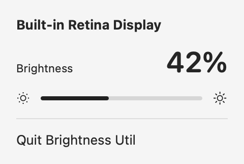

# Brightness Util

Simple menu bar utility that displays the current main-display brightness for macOS 27. The aim is to bring back the 16-cell brightness bar in the macOS 27 menu bar.



The project uses private DisplayServices/CoreDisplay SPI calls (mirroring the `nriley/brightness` fallback chain).

## Features

- Menu bar extra that mimics the classic 16-cell brightness HUD with crisp dot rendering.
- Compact popover showing the main display's name, brightness rounded to the nearest percent from the original reading, and a small brightness bar.
- Polling monitor that keeps the display in sync via DisplayServices/CoreDisplay/IOKit fallbacks.
- Runs as an accessory app so no Dock icon appears while the utility is active.
- SwiftUI-based implementation with reusable components for the tile and menu icon.

## Building from Terminal

You can build the app without opening Xcode. From the repository root run:

```bash
make app
```

This places the release `.app` bundle at `build/Build/Products/Release/brightness-util.app`.
The command-line build invokes the selected Xcode toolchain's Swift compiler directly, so it
does not depend on Xcode's IDE or simulator plugins. By default it produces a native-architecture,
ad-hoc-signed app targeting macOS 27 or later.

## Building a DMG

To build the release app and package it in an installable disk image, run:

```bash
make dmg
```

The resulting disk image is written to `dist/brightness-util.dmg`. Open it and drag
`brightness-util.app` onto the included Applications shortcut to install it.

You can override the scripts' build, signing, and output settings with environment variables.
For example:

```bash
SIGNING_IDENTITY="Developer ID Application: Example (TEAMID)" \
OUTPUT_DMG="$PWD/dist/brightness-util-signed.dmg" \
make dmg
```

The scripts use only tools included with macOS and Xcode (`swiftc`, `codesign`, `ditto`,
and `diskutil`, with `hdiutil` as a compatibility fallback); no separate DMG utility is
required. To repackage an existing release build without rebuilding it, run
`SKIP_BUILD=1 make dmg`.

## Launching

- To run immediately, execute `open build/Build/Products/Release/brightness-util.app`.
- For direct CLI execution, run `build/Build/Products/Release/brightness-util.app/Contents/MacOS/brightness-util`.
- Move the `.app` into `/Applications` (or anywhere else) to keep it handy between builds.

## Optional Signing & Distribution

- The generated DMG is suitable for local installation, but distributing it without Gatekeeper warnings requires signing and notarization. Those steps are not performed automatically because they require an Apple Developer identity and credentials.
- When distributing a zip instead, use Finder’s **Compress** option or `ditto -c -k --sequesterRsrc --keepParent brightness-util.app brightness-util.zip` to avoid stripping resource forks.

## Clearing the “App is Damaged” Warning

Unsigned or ad-hoc-signed builds that travel over AirDrop, Messages, or a downloaded `.zip`
pick up macOS’s quarantine flag. Gatekeeper may report that the app is damaged because it
does not have a trusted Developer ID signature. Remove the quarantine attribute and reopen it.

1. Copy `brightness-util.app` to a writable folder (e.g. `~/Applications`).
2. Run the following in Terminal, substituting the actual path if it differs:

   ```bash
   xattr -dr com.apple.quarantine "/Users/<username>/Applications/brightness-util.app"
   ```

3. Double-click the app again. The first launch will still show the usual “Unknown developer” prompt—choose **Open** to continue.

If they already tried to launch it once, System Settings → Privacy & Security will show an **Open Anyway** button for `brightness-util`. Clicking that clears the quarantine flag for that copy without using Terminal.

## Development Notes

- The SwiftUI preview for `ContentView` sits behind `#if DEBUG` so release builds skip the preview helper and avoid instantiating `BrightnessMonitor` outside Xcode previews.
